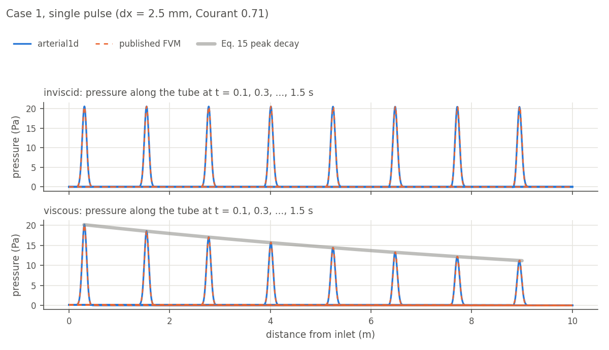
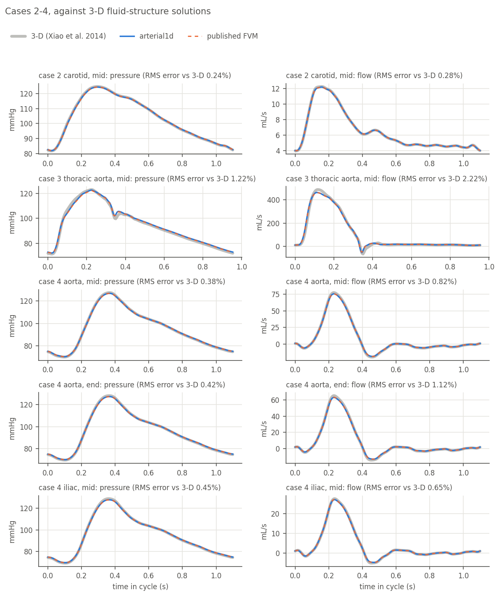
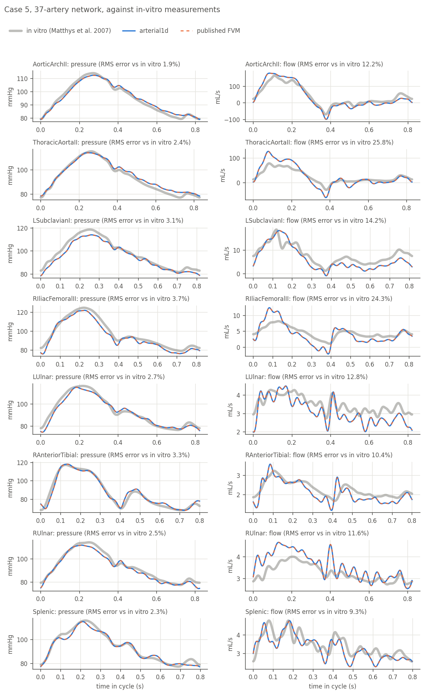
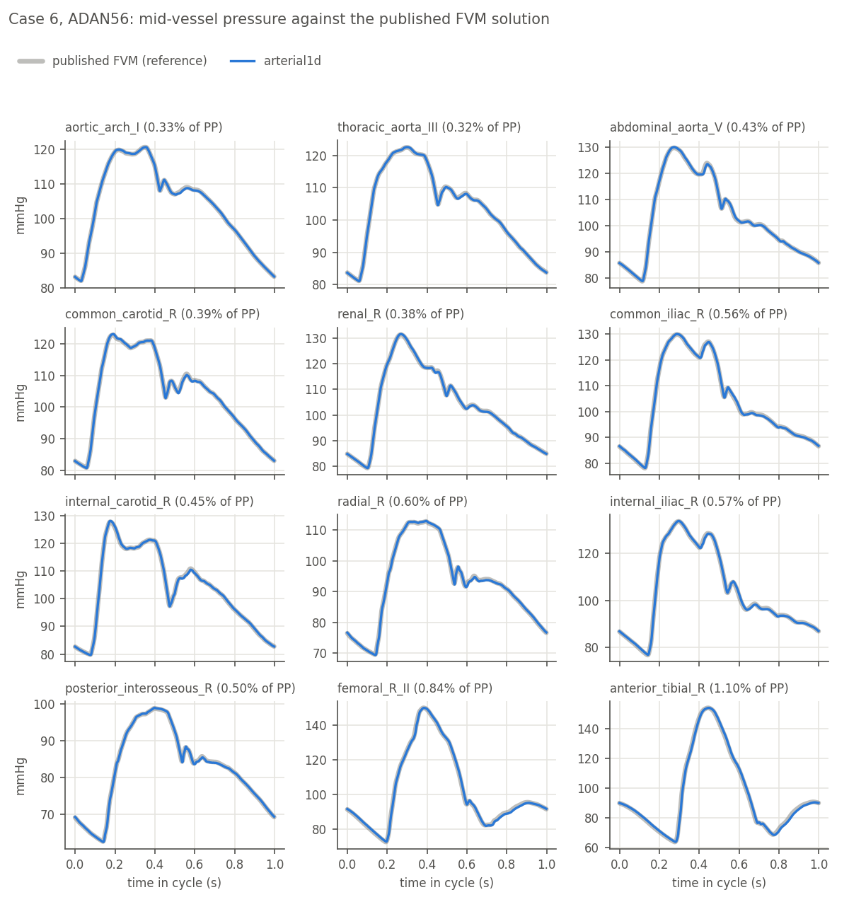

# arterial1d-ska

[](https://doi.org/10.5281/zenodo.24374689)

`arterial1d`: one-dimensional blood flow in trees of elastic arteries, in Python with Numba.
Source-available for noncommercial use (PolyForm Noncommercial 1.0.0; see *Licence*).

arterial1d is an independent implementation, compatible with the network file format of
[openBF](https://github.com/INSIGNEO/openBF). It solves the same family of equations with a
different numerical scheme (two-step MacCormack finite differences; openBF uses MUSCL finite
volumes). It is not a port of openBF.

Version 0.1.0. Validated against all six benchmark cases of Boileau et al. (2015): a single pulse
in a long tube, three cases against 3-D fluid–structure solutions, a 37-artery network against
in-vitro measurements, and the 56-artery ADAN56 network (see *Validation*).

## Install

```bash
pip install "git+https://github.com/MiningMyBusiness/arterial1d-ska.git"     # Python >= 3.10
```

or, from a clone, `pip install -e ".[test]"` and `pytest` (the published-benchmark tests skip
without their data). Dependencies: numpy, numba, pyyaml; matplotlib for the figures
(`pip install "arterial1d[figures]"` or `pip install -e ".[figures]"`).

## Use

```python
import arterial1d as a1

net = a1.load_network(a1.adan56_path())                         # any openBF YAML within the supported subset
q_in, period = a1.load_inlet(a1.openbf.inlet_path(a1.adan56_path()))
probes = {"arch": net.node("aortic_arch_I", 0.5), "wrist": net.node("radial_L", 0.95)}
res = net.simulate(q_in, period, n_cycles=10, probes=probes, P_init=net.P_ref)
res.P["wrist"] / a1.MMHG      # pressure [mmHg] at 1 kHz; also res.Q, res.A, per-cycle volumes
res.max_courant               # largest Courant number reached (must stay below 1)
```

Examples:

- [`examples/quickstart_adan56.py`](examples/quickstart_adan56.py): ADAN56 with its benchmark
  inflow; prints pressures at four sites and plots them.
- [`examples/custom_network.py`](examples/custom_network.py): an aortic bifurcation built in code
  from `Vessel` objects (radii at both ends, linear or exponential taper, stiffness from a Young's
  modulus and wall thickness or from end wave speeds; Windkessel or resistive outlets).

## Model

Per vessel, with area A, flow Q, pressure P:

    dA/dt + dQ/dx = 0
    dQ/dt + d(alpha Q^2/A)/dx + (A/rho) dP/dx = -K_R Q/A,     K_R = 2 (gamma + 2) pi mu / rho
    P = P_ext + beta(x) (sqrt(A) - sqrt(A0(x)))

- **Wall:** elastic tube law, beta = (4/3) sqrt(pi) E h / A0, i.e. c0 = sqrt(2 E h / (3 rho r)), with the
  wall thickness h given per vessel or, by default (and for openBF files without `h0`), from the
  thickness law used with ADAN56 in Boileau et al. (2015). A0 is the area at the reference pressure.
- **Friction:** velocity-profile exponent gamma from `gamma_profile` (default 2, i.e. 8 pi mu / rho).
  alpha = 1.
- **Interior scheme:** two-step MacCormack, second order, alternating direction each step. The
  pressure gradient is kept as (A/rho) dP/dx so that a uniform-pressure rest state is preserved
  exactly on tapered vessels.
- **Boundaries:** characteristic compatibility relations in pressure–velocity form, each reduced
  to a scalar Newton solve for the boundary pressure.
  - inlet: prescribed flow Q_in(t);
  - junctions: one parent and up to three daughters; mass conservation and continuity of
    **total** pressure P + rho u²/2 (static-pressure continuity is available, but on ADAN56 it
    gives 4.2% worst-case error against 1.1% for total pressure);
  - outlets: three-element Windkessel R1–C–R2, or a pure resistance R1 to a fixed outflow pressure;
    a pure resistance matched to the characteristic impedance is a (linearly) non-reflecting outlet.
- **Time step:** fixed for a run: `cfl * dx / (c_headroom * c0)` over the network, with c0 the wave
  speed at the reference area, rounded down to divide the recording interval. Defaults `cfl = 0.9`,
  `c_headroom = 1.25`, `dx = 2.5 mm`. The headroom covers the rise of the wave speed with pressure
  and the flow speed; on ADAN56 the largest Courant number reached is 0.91. Every run reports it
  (`Result.max_courant`) and warns above 1. The smallest node spacing in the network (often a
  short vessel) sets the step, so most vessels run at a lower Courant number; MacCormack damps
  short waveform features more at low Courant numbers (case 1 below).

## Validation

**Case 1, single pulse** (10 m elastic tube, Gaussian inflow pulse about 31 cm long, absorbing
outlet; inviscid and viscous). The paper reports no error table; it checks that the inviscid peak
changes by less than 0.9% along the tube and that the viscous peak follows the exponential decay of
its Eq. 15.

| arterial1d | Courant number | inviscid peak change | viscous / Eq. 15 | profile RMS vs FVM, % of peak |
| --- | --- | --- | --- | --- |
| **dx = 2.5 mm, defaults** | **0.71** | **−0.56%** | **+0.30 to +0.42%** | **0.65** |
| dx = 1.25 mm, defaults | 0.72 | +0.15% | +0.38 to +0.46% | 0.17 |
| dx = 2.5 mm, cfl 0.95, c_headroom 1.05 | 0.88 | +0.01% | +0.36 to +0.41% | 0.30 |
| dx = 5 mm, defaults | 0.69 | −7.9% | +0.24 to +0.37% | 2.3 |
| dx = 2.5 mm, cfl 0.8, c_headroom 1.6 (before 0.1.0) | 0.49 | −1.32% | +0.35 to +0.41% | 0.97 |

The published schemes differ from Eq. 15 by 0.2–0.8%. The peak travels at 6.17 m/s, the tube-law
wave speed. **Numerical damping of short features depends on the grid and the Courant number.** The
pulse here is about 31 cm long; at dx = 5 mm it loses 8% of its peak over 8.6 m. For waveforms with
sharp features use dx ≤ 2.5 mm. On ADAN56, raising the Courant number (0.47 to 0.71) changes neither
the errors nor the distal timing lag below.



Error measures and comparison protocol are those of Boileau et al. (2015). The benchmark code
reproduces the paper's published FVM errors against 3-D (Tables IV, VI and VIII) from the published
files to within 0.035 percentage points, and Table X (against in vitro, case 5) within 0.15,
which checks the metrics and the time alignment independently of arterial1d. Errors of the
published schemes below are the paper's.

**Case 2, common carotid artery** (single elastic vessel, three-element Windkessel; reference: the
3-D fluid–structure solution of Xiao et al. 2014). Mid-vessel pressure P, flow Q, change in radius
dr and inlet–outlet pressure drop dP over one cycle, dx = 2.5 mm (converged: 1 mm and 0.5 mm give
the same values to 0.01).

| RMS error vs 3-D, % | P | Q | dr | dP |
| --- | --- | --- | --- | --- |
| **arterial1d** | **0.24** | **0.28** | **1.01** | **4.26** |
| six published schemes (Table IV) | 0.20–0.28 | 0.26–0.39 | 0.96–1.07 | 4.21–4.47 |

On all 16 measures (RMS, maximum, systolic, diastolic for the four quantities) arterial1d falls
within the published schemes' range. Its RMS pressure difference from the published FEM and
MacCormack solutions is 0.01% and under 0.01%.

**Case 3, upper thoracic aorta** (single elastic vessel, 24 cm, high flow).

| RMS error vs 3-D, % | P | Q | dr | dP |
| --- | --- | --- | --- | --- |
| **arterial1d** | **1.22** | **2.22** | **2.43** | **7.23** |
| six published schemes (Table VI) | 1.08–1.21 | 2.17–2.55 | 2.32–2.90 | 7.14–7.70 |

10 of 16 measures fall within the published range; the other six lie next to the LCG scheme's.
The supplement's inflow formula, used here, carries a mean flow of 103.09 mL/s; the 3-D solution
and five of the six published solutions carry 102.80–102.84 mL/s (LCG: 103.07). The extra 0.27%
of flow raises mean pressure by about 30 Pa. With the inflow scaled to the 3-D mean (a diagnostic,
not the reported result), arterial1d's RMS pressure error is 1.09% and it differs from FVM, FEM,
DCG, McC and STM by 0.05–0.09% RMS pressure.

**Case 4, aortic bifurcation** (aorta and two iliac arteries, one junction).

| RMS error vs 3-D, % | aorta mid P / Q / dr | aorta end P / Q / dr | iliac mid P / Q / dr |
| --- | --- | --- | --- |
| **arterial1d** | **0.38 / 0.82 / 2.47** | **0.42 / 1.12 / 4.06** | **0.45 / 0.65 / 4.29** |
| published (Table VIII) | 0.37–0.40 / 0.71–0.89 / 2.43–2.55 | 0.41–0.44 / 0.46–1.20 / 4.02–4.14 | 0.44–0.47 / 0.65–0.92 / 4.26–4.35 |

All 36 measures fall within the published range, and arterial1d differs from the published FEM
and MacCormack solutions by about 0.01% RMS pressure at all three sites.



**Case 5, 37-artery in-vitro network** (Matthys et al. 2007: silicone tubes, 37 segments of which
22 tapered, 16 resistive outlets; reference: measured pressure and flow at 8 sites). The paper does
not list which segment each site is; matching every segment and position against the published
FVM output identifies all eight unambiguously as segment midpoints (10, 17, 11, 29, 14, 34, 7, 20).

| RMS error vs in vitro, % | pressure, 8 sites | flow, 8 sites |
| --- | --- | --- |
| **arterial1d** | **1.86–3.73** | **9.3–25.8** |
| published FVM (Table X) | 1.87–3.75 | 9.2–25.4 |

58 of 64 measures fall within the published schemes' range; the six outside are flow extremes and
the thoracic aorta's RMS flow, within 1.2 points of the range. arterial1d differs from the published
FVM solution by 0.05–0.14% RMS pressure and 0.16–0.35% RMS flow, with no timing lag (≤ 0.2 ms) at
the distal sites. Results are grid-converged at dx = 2.5 mm (1.25 mm changes them by ≤ 0.02).



Cases 2–5 show no timing lag against FVM (case 3: −0.3 ms over 24 cm; case 5: ≤ 0.2 ms through a
tapered tree). Reproduce with
`python scripts/benchmark_boileau.py {carotid,thoracic_aorta,bifurcation,network37} --data <folder>`.

**ADAN56** (Boileau et al. 2015, benchmark 6; 56 arteries in 77 segments, 31 Windkessel outlets).
Bundled network and inflow from openBF. Mid-vessel pressure over the last of 15 cycles, dx = 2.5 mm,
compared with the published finite-volume (FVM) solution at the 12 published sites. Metric: RMS
difference as % of the reference pulse pressure.

| Solution vs published FVM | median | worst site |
| --- | --- | --- |
| **arterial1d** | **0.50%** | **1.10%** (anterior tibial) |
| published FEM | 0.15% | 0.23% |
| published DCG | 0.12% | 0.18% |
| published LCG | 0.28% | 0.51% |
| published MacCormack | 0.44% | 1.48% |
| published STM | 2.43% | 4.47% |

Diastolic, mean and systolic pressures agree within 0.4 mmHg at every site. Flow RMS differences
are 0.2–1.6% of peak flow. The worst sites are distal: arterial1d's pulse arrives up to 2.7 ms
later than the FVM solution's at the anterior tibial, and this lag does not shrink with grid
(1.25–5 mm) or time-step refinement. Its cause is not yet known. Cases 2–5, including the tapered
37-artery tree, show no such lag, and the bundled ADAN56 geometry and outlets match the benchmark's
own `mesh.txt` to 2e-8; wall stiffness (per-vessel E with the thickness law) and the momentum-flux
coefficient are the remaining suspects.



Reproduce with `python scripts/benchmark_adan56.py --data <folder>` (see *Reference data*). All
figures: `python scripts/make_figures.py --data <folder>`.


## Limitations

- Elastic walls only (no viscoelasticity).
- Trees only: one inlet, one parent per vessel, at most three daughters; no anastomoses or loops.
- Inlet: prescribed flow only (no pressure inlet). Outlets: three-element Windkessel or pure
  resistance (no reflection-coefficient outlets).
- A subset of openBF's YAML options. The reader raises `UnsupportedFeature` for anything else
  rather than ignoring it.
- One fixed time step for the whole network, set by its smallest node spacing; no local time
  stepping. Runs whose pressures raise the wave speed beyond the headroom warn (Courant number > 1).
- No speed comparison with other solvers has been made on a matched test. For scale, ADAN56 at
  the default dx = 2.5 mm runs in about 0.16 s per cardiac cycle on one core.

## Reference data

The Boileau et al. (2015) supplementary data are the publisher's and are not included here. Download
the supplementary archive from the article page (doi:10.1002/cnm.2732), unpack it, then:

```bash
python scripts/check_reference_data.py /path/to/SuppMaterial_1DBenchmark_Boileau_etal
export ARTERIAL1D_BOILEAU_DIR=/path/to/SuppMaterial_1DBenchmark_Boileau_etal
pytest tests/test_benchmarks.py
```

## Citing

If you use arterial1d, please cite the software, preferably the version you used:

> K. Bhattacharyya, *arterial1d-ska: one-dimensional blood flow in elastic arterial trees*,
> version 0.1.0 (2026). Zenodo. https://doi.org/10.5281/zenodo.24374690

```bibtex
@software{bhattacharyya_arterial1d_2026,
  author    = {Bhattacharyya, Kiran},
  title     = {arterial1d-ska: one-dimensional blood flow in elastic arterial trees},
  version   = {0.1.0},
  year      = {2026},
  publisher = {Zenodo},
  doi       = {10.5281/zenodo.24374690},
  url       = {https://doi.org/10.5281/zenodo.24374690}
}
```

To refer to the software in general rather than one version, use the all-versions DOI
[10.5281/zenodo.24374689](https://doi.org/10.5281/zenodo.24374689), which resolves to the latest
release. GitHub's "Cite this repository" button reads `CITATION.cff`.

Please also cite the sources of the network and benchmark:

- E. Boileau et al., "A benchmark study of numerical schemes for one-dimensional arterial blood
  flow modelling", Int. J. Numer. Meth. Biomed. Engng 31 (2015) e02732. doi:10.1002/cnm.2732
- K. S. Matthys et al., "Pulse wave propagation in a model human arterial network: assessment of 1-D
  numerical simulations against in vitro measurements", J. Biomech. 40 (2007) 3476–3486 (case 5
  in-vitro data).
- N. Xiao, J. Alastruey, C. A. Figueroa, "A systematic comparison between 1-D and 3-D hemodynamics in
  compliant arterial models", Int. J. Numer. Meth. Biomed. Engng 30 (2014) 204–231 (3-D reference
  solutions of cases 2–4).
- P. J. Blanco et al., "An anatomically detailed arterial network model for one-dimensional
  computational hemodynamics", IEEE Trans. Biomed. Eng. 62 (2015) 736–753.
- I. Benemerito, A. Melis, A. Wehenkel, A. Marzo, "openBF: an open-source finite volume 1D blood
  flow solver", Physiol. Meas. 45 (2024) 125002. doi:10.1088/1361-6579/ad9663 (network file format
  and the bundled ADAN56 files)

## Licence

[PolyForm Noncommercial License 1.0.0](https://polyformproject.org/licenses/noncommercial/1.0.0)
(`LICENSE`): free for noncommercial purposes, including personal research and use by
educational, public-research, charitable and government institutions. Commercial use needs a
separate licence; contact the author through GitHub.

This is not an OSI open-source licence. The ADAN56 network and inflow files in
`src/arterial1d/data/adan56/` are from openBF and remain under the Apache License 2.0
(`src/arterial1d/data/adan56/LICENSE-Apache-2.0`); see `NOTICE`.
